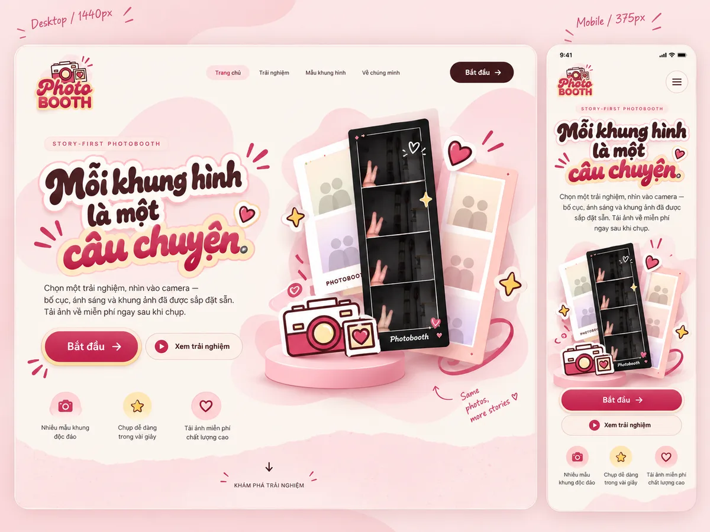
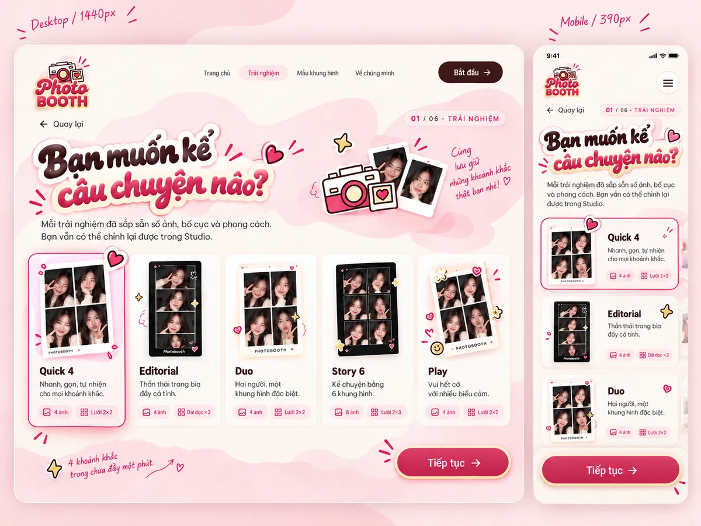
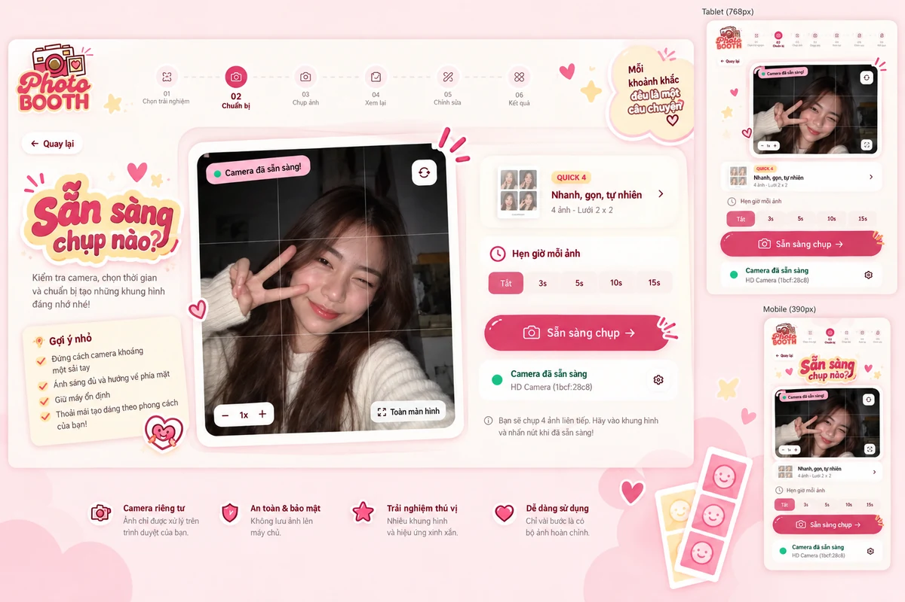
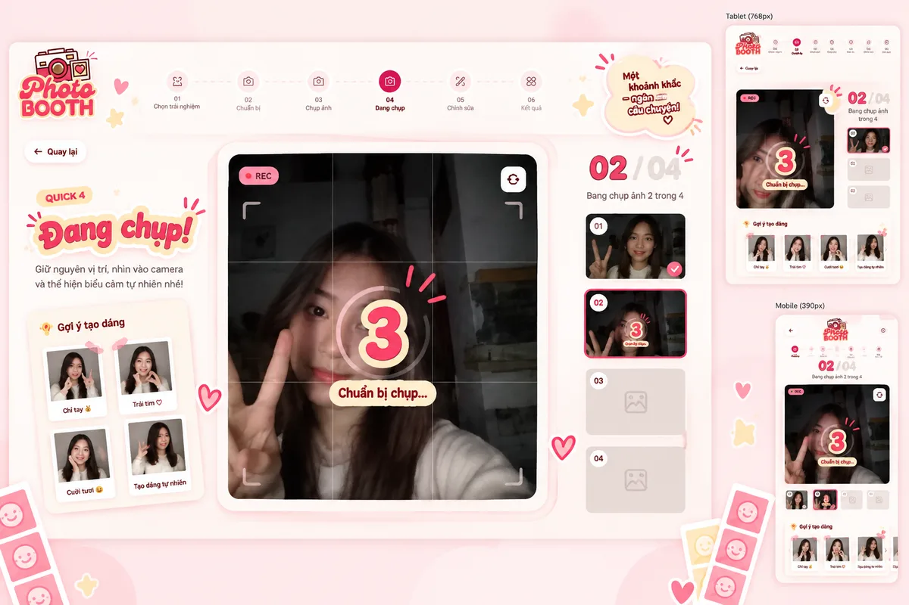
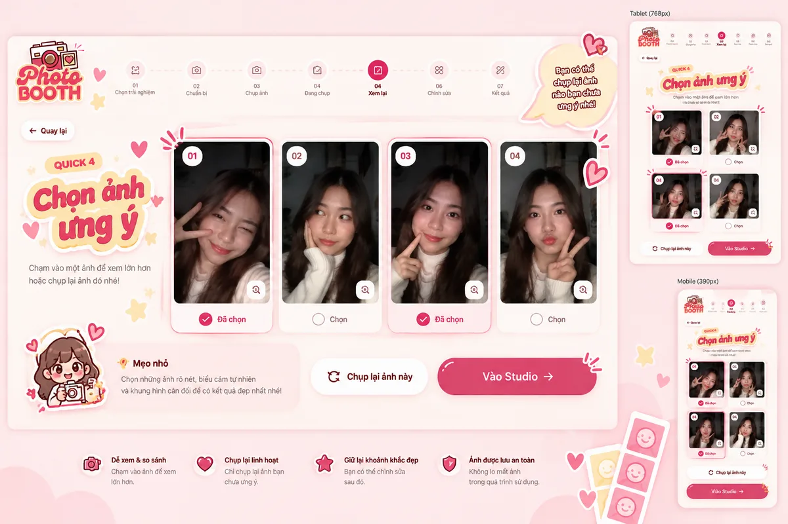
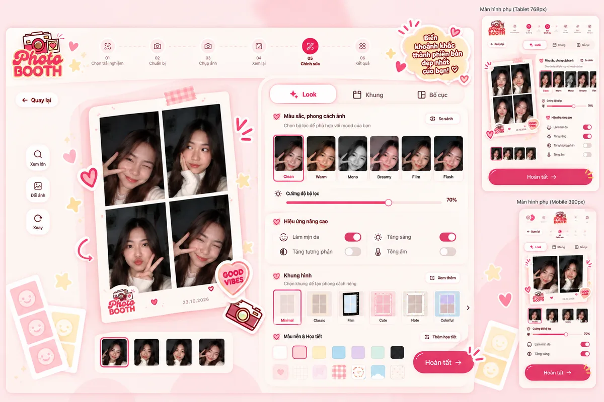

<p align="center">
  
</p>

<h3 align="center">Mỗi khung hình là một câu chuyện</h3>

<p align="center">
  Photobooth chạy hoàn toàn trên trình duyệt: chọn trải nghiệm, chụp, chỉnh và tải ảnh PNG.<br>
  Ảnh không bao giờ rời khỏi máy của bạn.
</p>

<p align="center">
  <a href="https://lahieuphong.github.io/photobooth/"><b>Dùng thử</b></a> ·
  Next.js 15 · React 19 · Tailwind CSS 4 · TypeScript
</p>



## Tính năng

- **5 trải nghiệm dựng sẵn**: số ảnh, bố cục, tông màu, khung và gợi ý tạo dáng đã chọn sẵn.
- **Chụp ngay trên trình duyệt**: camera trước được lật như gương, hẹn giờ Tắt / 5s / 10s / 15s, chụp lại từng ảnh.
- **Studio**: 5 tông màu (Clean, Warm, Mono, Dreamy, Flash), 4 khung (Không khung, Minimal, Editorial, Play) và 3 bố cục (Lưới 2×2, Dải dọc ×2, Lưới 2×3). Ảnh gốc không bị thay đổi.
- **Tải ảnh PNG** 1800×2349 px, đủ in 4×6".
- **Riêng tư**: ảnh lưu trong IndexedDB của trình duyệt, không tải lên máy chủ nào.
- **Chế độ kiosk** cho máy dùng chung: tự kết thúc phiên và xóa ảnh khi không có ai dùng.

## Trải nghiệm

| Quick 4 | Editorial | Duo | Story 6 | Play |
|:-:|:-:|:-:|:-:|:-:|
|  |  |  |  |  |
| Nhanh, gọn, tự nhiên | Thần thái trang bìa | Hai người, một khung hình | Kể chuyện bằng 6 khung hình | Vui hết cỡ |
| 4 ảnh · Lưới 2×2 | 4 ảnh · Dải dọc ×2 | 4 ảnh · Lưới 2×2 | 6 ảnh · Lưới 2×3 | 4 ảnh · Lưới 2×2 |

## Luồng sử dụng

```
Trang chủ → 01 Trải nghiệm → 02 Chuẩn bị → 03 Chụp → 04 Xem lại → 05 Studio → 06 Kết quả
                                             ↑            │
                                             └─ chụp lại ─┘
```

Mỗi bước được kiểm tra quyền truy cập: mở thẳng link hoặc tải lại trang khi không có phiên phù hợp sẽ chuyển về bước hợp lệ gần nhất.

| Chọn trải nghiệm | Chuẩn bị |
|:-:|:-:|
|  |  |
| **Chụp** | **Xem lại** |
|  |  |
| **Studio** | **Kết quả** |
|  |  |

<sub>Ảnh trên là bản thiết kế UI; giao diện thực tế có thể khác đôi chút.</sub>

<details>
<summary><b>Nhận diện thương hiệu</b></summary>


</details>

## Chạy dự án

Cần Node ≥ 22.18. Lockfile dùng Yarn 1; nếu `yarn` trên máy là bản 2+, hãy chạy qua Corepack để không ghi đè lockfile:

```bash
corepack yarn@1.22.22 install --frozen-lockfile
corepack yarn@1.22.22 dev         # http://localhost:3000/welcome
```

| Lệnh | Việc làm |
|---|---|
| `lint` · `typecheck` | ESLint và TypeScript |
| `test` | Unit test (`node:test`) cho phần logic |
| `build` | Xuất static site ra `./out` (base path `/photobooth`) |
| `test:e2e` | Playwright trên bản build, dùng camera giả của Chromium |

```bash
corepack yarn@1.22.22 playwright install --no-shell chromium   # một lần cho mỗi máy
corepack yarn@1.22.22 build && corepack yarn@1.22.22 test:e2e
```

Mỗi lần push lên `main`, GitHub Actions chạy lần lượt typecheck → lint → unit test → build → E2E, rồi deploy lên GitHub Pages. Pull request chạy đủ các bước nhưng không deploy.

<details>
<summary><b>Kiến trúc</b></summary>

```
app/(photobooth)/<route>/page.tsx    file route mỏng
src/features/photobooth/
  components/screens/<route>/        mỗi route một màn hình
  components/shared/                 brand, camera, bố cục ảnh in, controls, layout
  config/                            routes, các bước, trải nghiệm, ảnh demo
  domain/                            logic thuần: phiên chụp, route guard, bố cục, khung, tông màu
  hooks/                             useCamera, usePhotoboothSession, usePhotoUrls, …
  services/                          camera, xuất PNG, lưu trữ
tests/                               unit test và e2e (Playwright)
```

- **Một nguồn hình học duy nhất**: `domain/layouts.ts` định nghĩa mọi ô ảnh trên tờ in 1200×1566. Bản xem trước, khung SVG và ảnh PNG đều dựa vào đó. Khi xuất ảnh, mỗi lần chỉ giải mã một ảnh để tiết kiệm bộ nhớ.
- **Ảnh lưu nguyên bản**: ảnh JPEG chưa lọc nằm trong IndexedDB, thông tin phiên là JSON nhỏ trong `sessionStorage`. Tông màu chỉ áp khi hiển thị (CSS) và khi xuất (`ctx.filter`, có phương án dự phòng theo từng pixel).
- **Camera**: màn Chuẩn bị và Chụp dùng chung một `MediaStream`, nên camera không phải mở lại khi chuyển màn. Nếu camera khởi động quá 12 giây, app báo lỗi nhưng vẫn dùng stream nếu nó đến muộn.
- **Phiên chụp**: mỗi tab giữ phiên của mình bằng Web Lock và có heartbeat. Phiên bị bỏ quá 24 giờ sẽ được dọn. Nếu IndexedDB không dùng được, ảnh được giữ trong RAM và app cảnh báo rõ.
- **Kiosk**: mở trang một lần với `?kiosk=1` (15 phút), `?kiosk=<số phút>` hoặc `?kiosk=off` để tắt. Việc chụp và xuất ảnh không bao giờ bị ngắt giữa chừng.
- **Hiệu năng**: ảnh demo có bản 160/320 px, font được cắt bớt ký tự và chỉ tải trước các font cần thiết, hiệu ứng chuyển động tạm dừng khi ra khỏi màn hình và tôn trọng cài đặt giảm chuyển động.

</details>

<details>
<summary><b>Ảnh demo và font</b></summary>

- 22 ảnh mẫu WebP trong `public/images/demo/` chỉ dùng cho trang giới thiệu, không bao giờ đi vào phiên chụp hay ảnh xuất. Bộ ảnh gốc nằm trong thư mục `design-inputs/` (không commit). `scripts/demo-collections.json` ghi lại tên file, checksum và các bước chỉnh.
- Tạo lại ảnh: `corepack yarn@1.22.22 demo:assets --import-from ./original-collections`, sau đó chạy `demo:variants` để tạo bản 160/320 px và cập nhật `config/demoImageVariants.ts`.
- Font Baloo 2 và nhãn Newsreader là bản đã cắt bớt ký tự (giấy phép OFL nằm cạnh file font). Tạo lại bằng `scripts/subset-bubble-font.py` và `scripts/subset-print-label-font.py` (cần `fonttools[woff]==4.57.0`). Đây là công cụ tùy chọn, build bình thường không cần.

</details>
